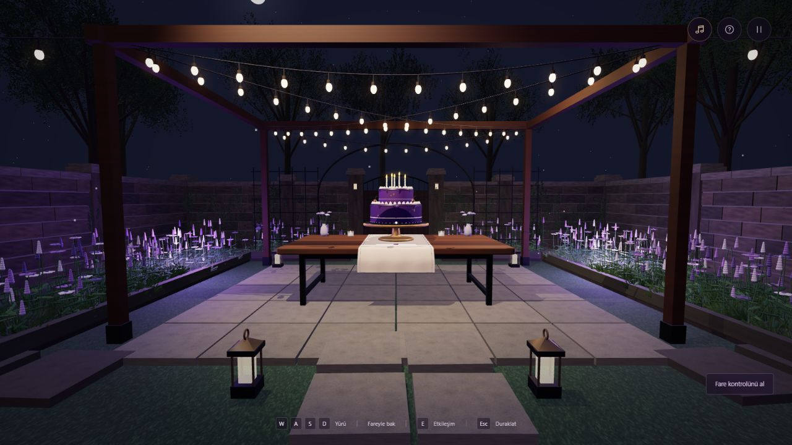

# Bir Dilek Gecesi

[](https://github.com/ahmetsn34/BirthdayAppForHer/actions/workflows/ci.yml)

A small, walkable night garden built with Three.js and browser-native JavaScript. Follow the lights, open a note, make a wish and blow out the candles.

Originally created as a personal birthday gift, the project brings together procedural scene design, first-person interaction and synthesized music. The portfolio version presents the same experience with neutral copy. The interface is in Turkish.

**[Explore the live demo](https://ahmetsn34.github.io/BirthdayAppForHer/portfolio.html?demo=1)**



## Experience

- Walk through a 3D garden with collision-aware movement and object targeting.
- Read a note, extinguish and relight candles, and discover a small hidden interaction.
- Use a mouse and keyboard or an on-screen joystick and touch gestures.
- Listen to a music-box melody synthesized with the Web Audio API after a user gesture.
- Pause, reset your position or switch off the music. Reduced-motion preferences reduce scene animation.
- If scene initialization fails after the app loads, a text-note fallback remains available.

## Run locally

Use **Node.js 24**. There is no build step or package installation required: Three.js is vendored in `dist/vendor/`.

```sh
git clone https://github.com/ahmetsn34/BirthdayAppForHer.git
cd BirthdayAppForHer
npm run dev
```

Open **[http://127.0.0.1:4173/portfolio.html?demo=1](http://127.0.0.1:4173/portfolio.html?demo=1)** in a browser with WebGL support. Serve the files over HTTP rather than opening the HTML file directly.

The default `/` page retains the original gift experience. The shared `portfolio.html?demo=1` entry has neutral static title, description and greeting, including before JavaScript loads. The original content remains in the repository; demo mode changes presentation, not access to the source.

## Controls

| Action | Desktop | Touch |
| --- | --- | --- |
| Move | W / A / S / D; up/down arrows | Left joystick |
| Look | Mouse; left/right arrows | Drag the scene |
| Interact | E or click when nearby | Tap an object or interaction button |
| Pause / resume | Esc or pause button | Pause button |
| Music | M or music button | Music button |
| Help | H or help button | Help button |

If pointer lock is unavailable, press and drag to look around.

## Architecture

The app uses HTML, CSS and JavaScript ES modules, with no frontend framework or backend service. Scene geometry and lighting are assembled in code; audio is generated in the browser.

| Module | Responsibility |
| --- | --- |
| `dist/app.js` | App state, dialogs, controls and scene lifecycle |
| `dist/garden.js`, `dist/garden-details.js` | Three.js scene, lighting, environment and interactable objects |
| `dist/player.js` | First-person movement, collision handling, pointer/touch input and targeting |
| `dist/cake.js` | Cake geometry, candle state and effects |
| `dist/audio.js` | Synthesized music and audio lifecycle |
| `dist/content.js`, `dist/experience-content.js` | Original text and opt-in neutral demo copy |
| `dist/config.js` | Optional validated YouTube link for the hidden interaction |
| `server.mjs` | Small local static server |

GitHub Pages uses the root `portfolio.html`, which resolves assets from `dist/`. The local server serves `dist/portfolio.html`. Relative asset paths support hosting under the repository subpath.

## Checks

```sh
npm run check
npm test
```

The current suite contains **14 tests** for collision behavior, demo content isolation, neutral static entries, project-subpath asset resolution, optional URL validation and local HTTP serving. The syntax check covers **18 JavaScript modules**. GitHub Actions runs both commands on Node.js 24 for pushes and pull requests.

These checks do not automate rendered WebGL output, full browser interactions, audio playback or real touch devices. The screenshot shows an actual desktop browser session; performance and input behavior still need manual checks on the target browser and device.
